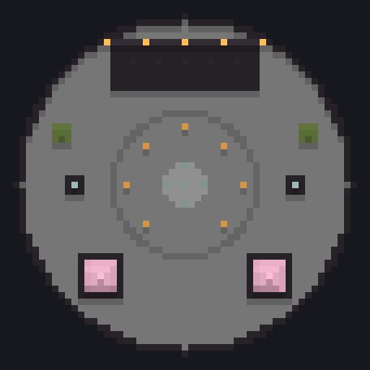
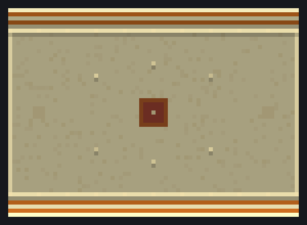
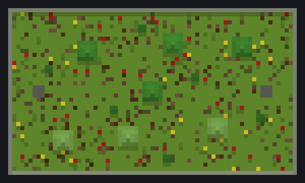
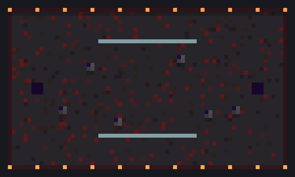
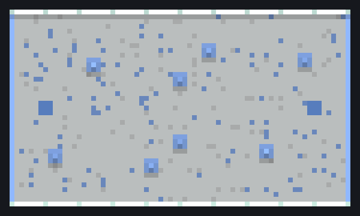
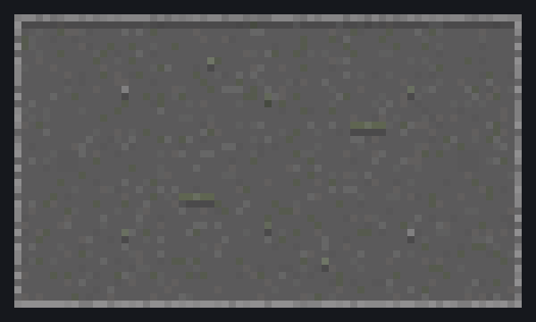

<h1 align="center">Practice Server Template</h1>

<p align="center">
  A ready-to-run PvP practice server for Paper 26.x, built around the classic practice server layout:<br>
  spawn in the lobby, right-click the book or walk up to an NPC, get matched, fight, repeat.
</p>

<p align="center">
  <a href="https://github.com/aubergine-ux/Practice-Server-Template/actions/workflows/smoke-test.yml"></a>
  
  
  
  
</p>

<p align="center">
  
</p>

Clone it, run one script, and you have a working practice server with a lobby, six arenas, ranked and unranked queues, ELO leaderboards and 1.8 style combat. Nothing to set up in-game unless you want to change things.

## What's in it

- **Queue the old way.** Right-click the book in your hotbar, or click one of the NPCs on the lobby stage (Unranked, Ranked, FFA, Kit Editor, Statistics).
- **Ranked and unranked** with ELO, divisions, win streaks and post-match inventories.
- **1.8 style combat.** No attack cooldown, sword blocking, old potions, gapples, rod and projectile knockback.
- **Kit editor, parties, FFA, spectating, events and rematches**, all from [ZonePractice Pro](https://modrinth.com/plugin/zonepractice-pro).
- **A lobby and six arenas** that build themselves on first boot. No world download, they're generated from commands in a datapack.
- **ELO leaderboard holograms** in the lobby, one global and one that cycles through the ladders.
- **Clients from 1.20 up can join**, thanks to ViaVersion and ViaBackwards.
- **Pinned versions.** Every jar is downloaded from Modrinth, Hangar or PaperMC and checked against a hash, so everyone running the template gets the same server.

## Quick start

You need **Java 25 or newer**. Check with `java -version`.

**Linux / macOS**

```sh
git clone https://github.com/aubergine-ux/Practice-Server-Template.git
cd Practice-Server-Template
./setup.sh
./start.sh
```

**Windows**

Download or clone the repo, double-click `setup.bat`, then `start.bat`.

**Docker**

Open `docker-compose.yml`, set `EULA: "true"` once you've read the [Minecraft EULA](https://aka.ms/MinecraftEULA), then:

```sh
docker compose up -d
docker attach practice    # console, detach with ctrl+p ctrl+q
```

The first start asks you to accept the EULA, downloads everything, and builds the maps. That takes about a minute. Join on `localhost` and you'll spawn in the lobby.

Heap size defaults to 4G. Change it with `MEMORY=6G ./start.sh` (or `set MEMORY=6G` on Windows, or the `MEMORY` line in the compose file).

## First things to change

| What | Where |
| --- | --- |
| Server address on the sidebar | `server/plugins/ZonePracticePro/sidebar.yml` (search for `play.example.net`) |
| MOTD, max players | `server/server.properties` |
| Give yourself admin | run `op <name>` in the console, then use LuckPerms for real ranks |
| Hotbar items | `server/plugins/ZonePracticePro/inventories.yml` |
| Knockback | `KNOCKBACK` in `server/plugins/ZonePracticePro/config.yml` |
| Usage stats | ZonePractice Pro sends anonymous stats to FastStats, opt out in `server/plugins/faststats/config.properties` |

Everything in `server/` is yours to edit. Running `./setup.sh` again never overwrites a config that already exists.

## Ladders

These are enabled out of the box, because they have arenas to play on:

| Ladder | Plays on |
| --- | --- |
| NoDebuff, Sword, Gapple, Archer, Soup, Axe, Boxing, Netherite Potion | Colosseum, Grove, Inferno, Glacier, Ruins |
| Sumo | Sumo |

ZonePractice also ships Build UHC, Crystal, Mace, Spear, SG, BedWars, Bridges, SkyWars and a few more. They're turned off because they need build arenas, which reset between matches and aren't included here. To use one, build an arena with the **Build** type (see below), then set `enabled: true` in `server/plugins/ZonePracticePro/ladders/<ladder>.yml` and add it back to the `CATEGORIES` lists in `config.yml`.

## Maps

All maps are original and built from `fill`/`setblock` commands, so they live in the repo as text instead of a world download. The lobby goes in the main world. The arenas go in ZonePractice's `arenas` world, 200 blocks apart on the x axis. Use `/practice arenas` to get there.

<table>
  <tr>
    <td align="center"><br>Colosseum</td>
    <td align="center"><br>Grove</td>
    <td align="center"><br>Inferno</td>
  </tr>
  <tr>
    <td align="center"><br>Glacier</td>
    <td align="center"><br>Ruins</td>
    <td align="center"><br>Sumo</td>
  </tr>
</table>

Want to change one? Edit `tools/generate_maps.py`, then run:

```sh
python3 tools/generate_maps.py      # rewrites the datapack in defaults/
python3 tools/render_previews.py    # updates the pictures (needs Pillow)
```

The maps only build on the first boot of a fresh world. To rebuild, delete `server/world` and copy the datapack in again with `./setup.sh`. If you move an arena, update its file in `defaults/plugins/ZonePracticePro/arenas/` too. Spawn and corner coordinates for every arena are in `tools/arenas.tsv`.

## Adding your own arena

Build it anywhere in the `arenas` world, then in-game:

1. `/arena create <name>` and pick **Basic** (or **Build** for build ladders).
2. `/arena setup <name>` gives you the wand. Left-click a block for corner 1, right-click for corner 2.
3. Shift + left-click to switch the wand to spawn points. Left-click the block under spawn 1, right-click the block under spawn 2. Face your opponent while you click, that's the direction players will look.
4. Press Q to drop the wand and leave setup.
5. `/setup` → Arena Manager → your arena → Ladder Types, and turn on the types it should host.
6. Hold an item, `/practice rename <gold>My Arena`, then `/arena set icon <name>`.
7. `/arena enable <name>`.

## Adding NPCs

The lobby NPCs are [FancyNpcs](https://modrinth.com/plugin/fancynpcs). For example, a party NPC:

```
/npc create party
/npc skin party @mirror
/npc displayname party <light_purple><bold>Party</bold>
/npc equipment party set mainhand name_tag
/npc action party any_click add player_command party create
/npc turn_to_player party true
```

`@mirror` shows each player their own skin, which is what the included NPCs use.

## Plugins

| Plugin | Used for | License |
| --- | --- | --- |
| [ZonePractice Pro](https://modrinth.com/plugin/zonepractice-pro) | queues, ELO, kits, arenas, sidebar, holograms | All rights reserved (free download) |
| [PacketEvents](https://github.com/retrooper/packetevents) | required by ZonePractice | GPL-3.0 |
| [OldCombatMechanics](https://hangar.papermc.io/kernitus/OldCombatMechanics) | 1.8 combat | MPL-2.0 |
| [FancyNpcs](https://github.com/FancyInnovations/FancyPlugins) | lobby NPCs | MIT |
| [ViaVersion](https://github.com/ViaVersion/ViaVersion) + [ViaBackwards](https://github.com/ViaVersion/ViaBackwards) | lets 1.20+ clients join | GPL-3.0 |
| [LuckPerms](https://github.com/lucko/LuckPerms) | permissions and ranks | MIT |
| [PlaceholderAPI](https://github.com/PlaceholderAPI/PlaceholderAPI) | placeholders | GPL-3.0 |
| [FastAsyncWorldEdit](https://github.com/IntellectualSites/FastAsyncWorldEdit) | building, arena copies | GPL-3.0 |
| [VoidGen](https://github.com/NicoNekoDev/VoidGen) | empty main world | GPL-3.0 |

No jars are committed. `setup.sh` downloads them from their official pages, so each plugin's own license applies.

## Updating

Versions are pinned in `versions.lock`, which is generated from `manifest.txt`. To update everything, or to add a plugin:

```sh
# edit manifest.txt if you want to add/remove something, then
./scripts/update-lock.sh    # needs curl + jq
./setup.sh                  # downloads the new jars, removes the old ones
```

Plugin configs in `server/` are left alone, so read the changelogs before jumping a major version.

## How it's laid out

```
manifest.txt            what to install (paper version + plugin slugs)
versions.lock           exact URLs + hashes, generated from the manifest
setup.sh / setup.ps1    download + verify everything into server/
start.sh / start.bat    run the server
defaults/               starter configs, maps datapack, arenas, npcs
tools/                  map generator + preview renderer
scripts/                lock updater + smoke test
server/                 the actual server (git-ignored)
```

## Smoke test

`scripts/smoke-test.sh` boots a fresh server, checks every plugin loads and the maps build, then shuts it down. GitHub Actions runs it on every push. It accepts the Minecraft EULA for that throwaway test server, so delete `.github/workflows/smoke-test.yml` if you don't want that in your copy.

## Notes

- This is a template, not a hosted network. Nothing here is affiliated with Mojang or Microsoft, or with any existing server.
- The repo's own files (scripts, maps, configs) are MIT licensed, see [LICENSE](LICENSE).
